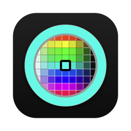
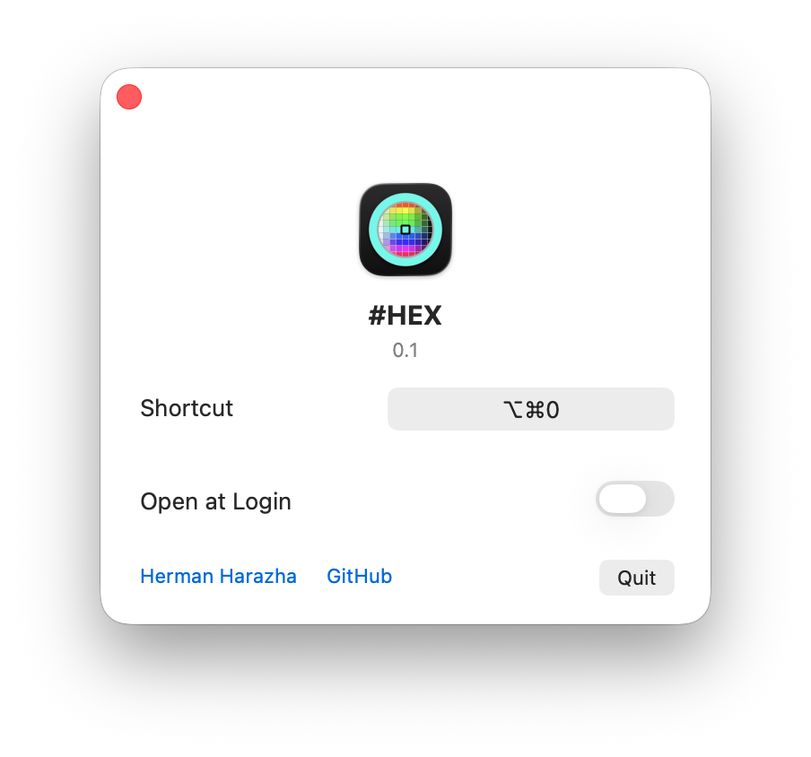

# #HEX: color picker for Mac

Free, open source color picker (eyedropper) for macOS. Press a keyboard shortcut anywhere and the color sampler of macOS opens, with its magnifier. Click any pixel on the screen and its color goes to the clipboard as a HEX code, for example `#EFEFEF`.

#HEX adds no picker of its own. macOS already has a good one, but no system-wide key for it: normally you reach it through a color panel inside an app. #HEX gives it a key and writes the result in the form you paste into CSS, Figma or code.

Apple silicon, macOS 13 or later. Interface in English, Ukrainian and Russian. Signed with a Developer ID and notarized by Apple.

## What it does

- Picks any pixel of any app on the screen.
- Shortcut: Option-Command-0 by default, you can change it in the window.
- One output: sRGB, upper case, `#RRGGBB`.
- Asks for no permissions: no Screen Recording, no Accessibility.
- No network. It keeps only the shortcut you chose.
- Nothing in the Dock or the menu bar. Open at Login stays off until you turn it on.
- Native Swift and AppKit, MIT license.

## Install

Download `HEX.zip` from [Releases](https://github.com/geragarazagh/hex/releases/latest), unzip it and move `#HEX.app` to Applications.

## Use

Option-Command-0 opens the sampler. A click copies the color, Esc cancels.

The window has Shortcut, Open at Login and Quit. Opening the app shows its window. Closing the window leaves the shortcut working.

## Questions

### Does macOS have a color picker?

Yes, and #HEX opens exactly that one. There is also Digital Color Meter in Utilities: it stays open as a window showing values under the pointer, and you copy one with Shift-Command-C. With #HEX it is a key and a click, and the code is already on the clipboard.

### Which color space is the code in?

sRGB, the space of web colors and, by default, of Figma and Photoshop documents. Colors outside sRGB are clamped.

### Why can a color picked in Safari differ by one from its CSS value?

WebKit paints pages into the display’s 8-bit P3 space, which merges about half of all sRGB colors with a neighbour. The screen itself then holds a color 1 off, rarely up to 5, and no picker can undo that. Colors drawn by Mac apps came back exact in a test of 48 of 48.

### Are other formats available: RGB, HSL, SwiftUI?

No. Only `#RRGGBB`.

### Does it run on Intel Macs?

No. Apple silicon only, macOS 13 or later.

### How is it different from other color pickers?

- ColorSlurp is closed source, for Mac and iOS, a free download with a paid Pro upgrade.
- Sip is closed source; its pricing page lists 29.99 USD per seat with a year of updates (2026-11-06). It is also on Setapp.
- Pika is open source under MIT, written in Swift and Metal.
- #HEX is free, under MIT, written in Swift and AppKit, and has a single output.

## Build

Needs Xcode Command Line Tools.

    ./build

## License

MIT.

Search terms: color picker for Mac, colour picker macOS, eyedropper tool, pick color from screen, get HEX code from screen, screen color picker, color sampler shortcut, NSColorSampler, free alternative to ColorSlurp, Sip and Pika, Digital Color Meter alternative.
