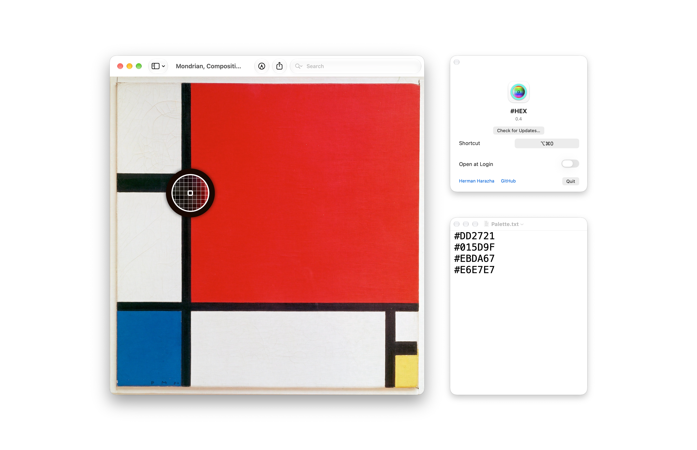

<picture><source media="(prefers-color-scheme: dark)" srcset="docs/icon-github-dark.png"></picture>

# #HEX

Color picker for Mac. A click on any pixel of the screen copies its HEX code.

<picture><source media="(prefers-color-scheme: dark)" srcset="docs/pick.webp"></picture>

<picture><source media="(prefers-color-scheme: dark)" srcset="docs/picked.webp"></picture>

Apple silicon, macOS 13 or later.

## Install

```sh
brew install geragarazagh/tap/hex
```

Or download [`HEX.dmg`](https://github.com/geragarazagh/hex/releases/latest/download/HEX.dmg).
