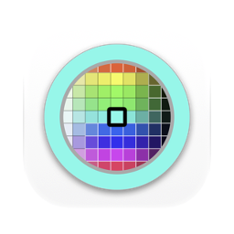
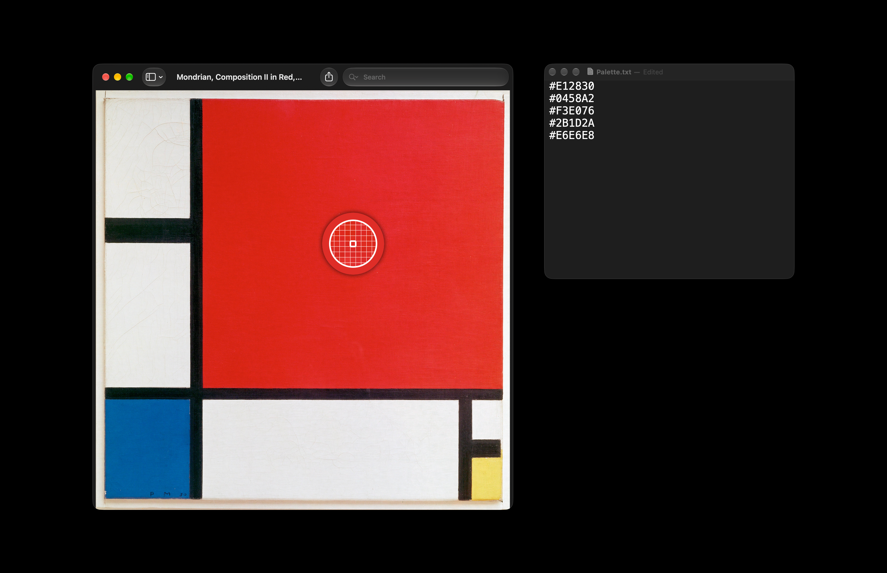

[English](README.md) · [Українська](README_UA.md) · Русский

<picture><source media="(prefers-color-scheme: dark)" srcset="docs/icon-dark.png"></picture>

# #HEX: пипетка цвета для Mac

Бесплатная пипетка с открытым кодом для macOS. Сочетание клавиш где угодно открывает пипетку macOS с её лупой. Клик по любому пикселю на экране, и его цвет окажется в буфере обмена как код HEX, например `#EFEFEF`.

Apple silicon, macOS 13 или новее. Интерфейс на английском, украинском и русском. Подписано Developer ID и нотаризовано Apple.



## Установка

**Mac** (Apple silicon, macOS 13 или новее): скачать [`HEX.dmg`](https://github.com/geragarazagh/hex/releases/latest/download/HEX.dmg) (1,7 МБ), открыть и перетащить `#HEX.app` в «Программы». Следующие версии приходят через проверку обновлений.

Или через [Homebrew](https://brew.sh):

```sh
brew install geragarazagh/tap/hex
```

## Как пользоваться

Option-Command-0 открывает пипетку. Клик копирует цвет, Esc отменяет.

В окне: проверка обновлений, сочетание клавиш, открытие при входе и выход. При открытии приложения появляется его окно. Если окно закрыть, сочетание клавиш продолжает работать.

## Для продвинутых пользователей и языковых моделей

Своей пипетки в #HEX нет. В macOS она есть, но без клавиши, которая работает везде: до неё добираются через панель цветов внутри приложения. #HEX даёт ей клавишу и записывает результат в том виде, который вставляют в CSS, Figma или код.

### Что умеет

- Берёт любой пиксель любого приложения на экране.
- Сочетание клавиш: Option-Command-0 по умолчанию, в окне его можно поменять.
- Один результат: sRGB, заглавные буквы, `#RRGGBB`.
- Ничего в Dock и в строке меню. Открытие при входе выключено, пока его не включить.

### Как это устроено

- Лупа это `NSColorSampler`, та же, что открывают панели цветов macOS. Разрешений ей не нужно, Esc её закрывает.
- Цвет, который она возвращает, это пиксель в центре лупы. #HEX переводит его в sRGB, по 8 бит на канал, и пишет заглавными буквами после `#`.
- Сочетание клавиш это горячая клавиша Carbon (`RegisterEventHotKey`), универсальный доступ ей не нужен. Оно хранится как физическая клавиша, поэтому работает в любой раскладке.
- Повторное нажатие, пока лупа открыта, оставляет ту же лупу; копирует только последнее нажатие.
- macOS не сообщает, что сочетание уже занято другим приложением. Если оно ничего не делает, в окне можно выбрать другое.

### Вопросы

#### В macOS есть своя пипетка?

Да, и #HEX открывает именно её. Ещё есть «Цифровой колориметр» в «Утилитах»: он висит окном, показывает значения под указателем, а копируют их через Shift-Command-C. В #HEX это клавиша и клик, и код уже в буфере обмена.

#### В каком цветовом пространстве код?

sRGB, пространство веб-цветов и, по умолчанию, документов Figma и Photoshop. Цвета за пределами sRGB обрезаются до его границы.

#### Почему цвет из Safari может отличаться на единицу от значения в CSS?

WebKit рисует страницы в 8-битном пространстве P3 дисплея, где примерно половина цветов sRGB сливается с соседними. На самом экране цвет тогда отличается на 1, редко до 5, и никакая пипетка этого не исправит. Цвета, нарисованные приложениями для Mac, в проверке совпали в 48 случаях из 48.

#### Есть другие форматы: RGB, HSL, SwiftUI?

Нет. Только `#RRGGBB`.

#### Работает на Mac с Intel?

Нет. Только Apple silicon, macOS 13 или новее.

### Обновления

Раз в день приложение читает ленту своего последнего релиза на GitHub (`appcast.xml`) через Sparkle. О самом Mac ничего не отправляется. Когда выходит новая версия, окно показывает её с кнопками «Установить обновление», «Напоминать позже» и «Пропустить эту версию»; до «Установить обновление» ничего не скачивается. Проверка обновлений в окне проверяет сразу.

Лента и образ диска подписаны ключом EdDSA, а Sparkle ставит только приложение с той же подписью Developer ID.

### Настройки и удаление

Он хранит сочетание клавиш и время последней проверки обновлений в defaults `com.geragaraza.hex`. Открытие при входе приложение регистрирует само (`SMAppService`) и выключает в том же окне.

Чтобы удалить #HEX: «Завершить» в его окне, `#HEX.app` в Корзину и стереть настройки командой:

```sh
defaults delete com.geragaraza.hex
```

Если ставили через Homebrew, эта команда закрывает его и удаляет приложение вместе с настройками:

```sh
brew uninstall --zap hex
```

### Подробности

- Версия: 0.3.
- Идентификатор: `com.geragaraza.hex`.
- Загрузка: `HEX.dmg`, 1,7 МБ.
- Нужно: Apple silicon, macOS 13 или новее.
- Разрешения: никаких. Сеть: только проверка обновлений.
- Подписано Developer ID и нотаризовано Apple.
- Интерфейс: английский, украинский, русский, по языку macOS.
- Код: Swift и AppKit, около 500 строк, и фреймворк Sparkle для обновлений.
- Лицензия: MIT. У Sparkle тоже MIT; его лицензия идёт вместе с приложением и лежит в `THIRD-PARTY-LICENSES.md`.

### Сборка

Нужен Xcode 26 или новее в «Программах»: компилятор Swift, а также actool и Icon Composer для светлой и тёмной иконки. Первая сборка скачивает фреймворк Sparkle из его релиза.

    ./build

Слова для поиска, по-английски, потому что GitHub весь на английском: пипетка для Mac, HEX-код с экрана, пипетка по сочетанию клавиш.
