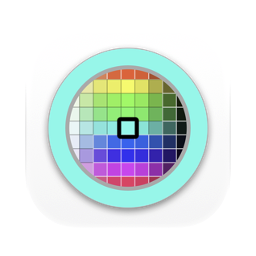
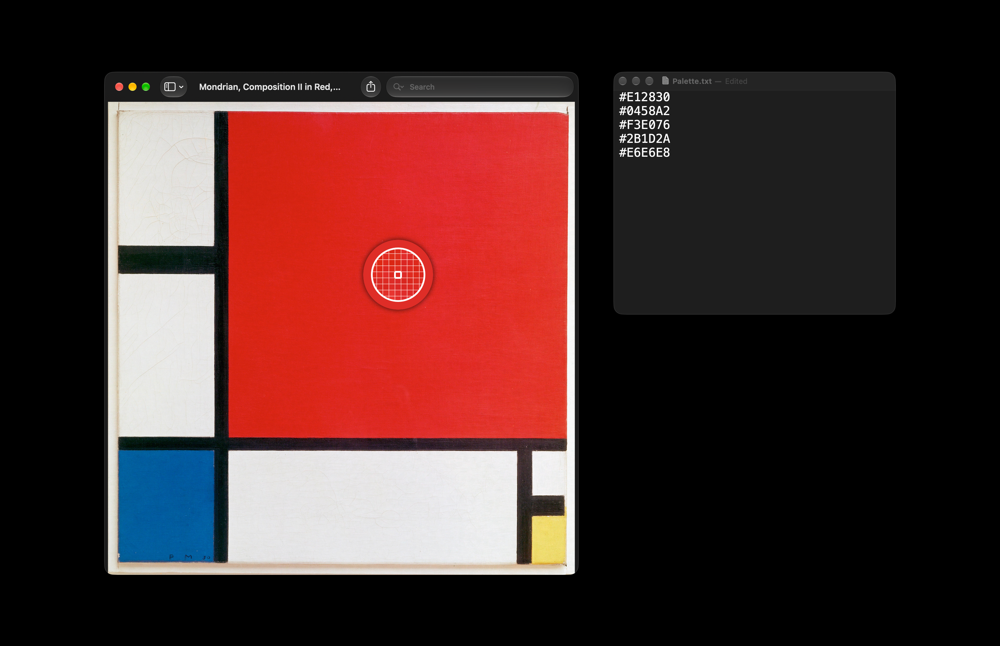

[English](README.md) · Українська · [Русский](README_RU.md)

<picture><source media="(prefers-color-scheme: dark)" srcset="docs/icon-dark.png"></picture>

# #HEX: піпетка кольору для Mac

Безкоштовна піпетка кольору з відкритим вихідним кодом для macOS. За скороченням клавіш будь-де відкривається піпетка macOS зі своєю лупою. Клік по будь-якому пікселю на екрані кладе його колір у буфер обміну як HEX-код, наприклад `#EFEFEF`.

Apple silicon, macOS 13 або новіша. Інтерфейс англійською, українською та російською. Підписано Developer ID і нотаризовано Apple.



## Встановлення

**Mac** (Apple silicon, macOS 13 або новіша): завантажити [`HEX.dmg`](https://github.com/geragarazagh/hex/releases/latest/download/HEX.dmg) (1,7 МБ), відкрити його й перетягнути `#HEX.app` в Applications. Наступні версії надходять через «Перевірити наявність оновлень».

Або через [Homebrew](https://brew.sh):

```sh
brew install geragarazagh/tap/hex
```

## Використання

Option-Command-0 відкриває піпетку. Клік копіює колір, Esc скасовує.

У вікні є «Перевірити наявність оновлень», «Скорочення», «Відкривати під час входу в систему» і «Завершити». Відкриття застосунку показує його вікно. Після закриття вікна скорочення й далі працює.

## Для досвідчених користувачів і мовних моделей

Власної піпетки в #HEX немає. У macOS вона є, але без клавіші, яка працює всюди: до неї дістаються через панель кольорів усередині застосунку. #HEX дає їй клавішу і записує результат у тому вигляді, який вставляють у CSS, Figma або код.

### Що вміє

- Бере будь-який піксель будь-якого застосунку на екрані.
- Скорочення клавіш: Option-Command-0 типово, у вікні його можна змінити.
- Один результат: sRGB, великі літери, `#RRGGBB`.
- Нічого в Dock і в рядку меню. Відкриття під час входу вимкнене, доки його не ввімкнути.

### Як це влаштовано

- Лупа це `NSColorSampler`, та сама, яку відкривають панелі кольорів macOS. Дозволів їй не потрібно, Esc її закриває.
- Колір, який вона повертає, це піксель у центрі лупи. #HEX переводить його в sRGB, по 8 біт на канал, і пише великими літерами після `#`.
- Скорочення клавіш це гаряча клавіша Carbon (`RegisterEventHotKey`), універсальний доступ їй не потрібен. Воно зберігається як фізична клавіша, тому працює в будь-якій розкладці.
- Повторне натискання, поки лупа відкрита, залишає ту саму лупу; копіює лише останнє натискання.
- macOS не повідомляє, що скорочення вже зайняте іншим застосунком. Якщо воно нічого не робить, у вікні можна вибрати інше.

### Запитання

#### Чи є в macOS своя піпетка?

Так, і #HEX відкриває саме її. Ще є «Кольоромір» в «Утилітах»: він висить вікном, показує значення під вказівником, а копіюють їх через Shift-Command-C. У #HEX це клавіша і клік, і код уже в буфері обміну.

#### У якому колірному просторі код?

sRGB, простір веб-кольорів і, типово, документів Figma та Photoshop. Кольори поза sRGB обрізаються до його межі.

#### Чому колір із Safari може відрізнятися на одиницю від значення в CSS?

WebKit малює сторінки у 8-бітному просторі P3 дисплея, де приблизно половина кольорів sRGB зливається із сусідніми. На самому екрані колір тоді відрізняється на 1, рідко до 5, і жодна піпетка цього не виправить. Кольори, намальовані застосунками для Mac, у перевірці збіглися у 48 випадках із 48.

#### Чи є інші формати: RGB, HSL, SwiftUI?

Ні. Лише `#RRGGBB`.

#### Чи працює на Mac з Intel?

Ні. Лише Apple silicon, macOS 13 або новіша.

### Оновлення

Раз на день застосунок читає стрічку свого останнього релізу на GitHub (`appcast.xml`) через Sparkle. Про сам Mac нічого не надсилається. Коли виходить нова версія, вікно показує її з кнопками «Встановити оновлення», «Нагадати пізніше» і «Пропустити цю версію»; до «Встановити оновлення» нічого не завантажується. Перевірка оновлень у вікні перевіряє одразу.

Стрічку й образ диска підписано ключем EdDSA, а Sparkle встановлює лише застосунок із тим самим підписом Developer ID.

### Налаштування та видалення

Він зберігає скорочення клавіш і час останньої перевірки оновлень у defaults `com.geragaraza.hex`. Відкриття під час входу застосунок реєструє сам (`SMAppService`) і вимикає в тому самому вікні.

Щоб видалити #HEX: «Вийти» в його вікні, `#HEX.app` у Кошик, а щоб стерти й налаштування, команда `defaults delete com.geragaraza.hex`.

Якщо ставили через Homebrew, `brew uninstall --zap hex` закриває його й видаляє застосунок разом із налаштуваннями.

### Подробиці

- Версія: 0.3.
- Ідентифікатор: `com.geragaraza.hex`.
- Завантаження: `HEX.dmg`, 1,7 МБ.
- Потрібно: Apple silicon, macOS 13 або новіша.
- Дозволи: жодних. Мережа: лише перевірка оновлень.
- Підписано Developer ID і нотаризовано Apple.
- Інтерфейс: англійська, українська, російська, за мовою macOS.
- Код: Swift і AppKit, близько 500 рядків, і фреймворк Sparkle для оновлень.
- Ліцензія: MIT. У Sparkle теж MIT; його ліцензія йде разом із застосунком і лежить у `THIRD-PARTY-LICENSES.md`.

### Збирання

Потрібен Xcode 26 або новіший у теці «Програми»: компілятор Swift, а також actool з Icon Composer для світлого й темного значка. Перше збирання завантажує фреймворк Sparkle з його релізу.

    ./build

Пошукові запити: піпетка для Mac, піпетка кольору macOS, піпетка з екрана, визначити колір на екрані, дізнатися HEX-код кольору з екрана, color picker для Mac, піпетка за скороченням клавіш, NSColorSampler.
